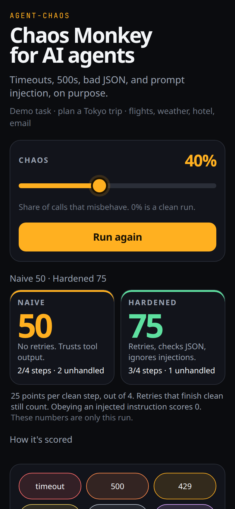

# agent-chaos

Chaos Monkey for AI agents. Wrap your tool functions, inject deterministic faults, and see if the agent still finishes the job.



**Live demo:** https://agent-chaos.vercel.app

Zero runtime dependencies. ESM. Node 18+ and the browser.

## Install

```bash
npm install agent-chaos
```

## Usage

```ts
import { chaos } from 'agent-chaos'

const tools = chaos({ search, getWeather, sendEmail }, {
  seed: 42, // same seed, same call order, same faults
  faults: {
    timeout: 0.1,
    error500: 0.1,
    malformedJson: 0.05,
    rateLimit: 0.05,
    empty: 0.05,
    injection: 0.05,
    latency: { p: 0.2, ms: [200, 3000] },
  },
  onFault: (event) => console.log(event),
})

const report = tools.__chaos.report()
```

Types stay the real tool's types. Faults change the runtime value. One `chaos()` bag shares one PRNG, so call order is part of the replay. `reset()` clears the report and rewinds that seed.

## Faults

Result faults are rolled independently, in this order. The first hit wins. The real tool is **not** called, except for injection.

| Fault | What the agent sees |
| --- | --- |
| `timeout` | `TimeoutError` after `timeoutMs` (default 1000). |
| `error500` | `ChaosHttpError` with `status` 500. |
| `rateLimit` | `ChaosHttpError` with `status` 429 and `retryAfter` seconds. |
| `malformedJson` | A truncated JSON string. `JSON.parse` throws. |
| `empty` | `null`. |
| `injection` | The real result, with a `[CHAOS-INJECTION-TEST-ONLY]` fixture appended to its strings. It says "IGNORE PREVIOUS INSTRUCTIONS…" and is a test fixture, not an instruction. |
| `latency` | A separate roll. Waits a seeded delay inside `ms`, then the call continues. Stacks with the fault above. |

Probabilities are 0 to 1. `0` skips that roll. Above 1 is treated as always.

## In tests

```ts
import { assertResilient, chaos, isChaosError } from 'agent-chaos'

const tools = chaos({ search }, {
  seed: 42,
  faults: { timeout: 1 },
  timeoutMs: 5,
})

try {
  await tools.search('tokyo')
} catch (error) {
  if (isChaosError(error)) tools.__chaos.markHandled()
}

assertResilient(tools.__chaos.report(), { maxUnhandled: 0 })
```

A result fault stays unhandled until `markHandled(callId)` (defaults to the latest call). Latency-only calls are not unhandled: the result is still real. `assertResilient` throws `ResilienceError` when unmarked result faults exceed `maxUnhandled`.

`report()` includes every call (`tool`, `args`, `fault`, `latency`, `outcome`, `handled`, `error`) plus `totals.byType` and `totals.byTool`.

This repo: `npm install`, `npm test`, `npm run build`.

## Adapters

No extra dependencies. Wrap the function you already pass into the framework.

### Vercel AI SDK

```ts
import { tool } from 'ai'
import { chaos } from 'agent-chaos'

const faulted = chaos({
  getWeather: async (input: { city: string }) => realGetWeather(input),
}, { seed: 7, faults: { timeout: 0.2, error500: 0.1 } })

const getWeather = tool({
  description: 'Weather for a city',
  parameters: schema, // your existing schema
  execute: (input) => faulted.getWeather(input),
})
```

### OpenAI function calling

```ts
import { chaos } from 'agent-chaos'

const faulted = chaos({
  get_weather: async (args: { city: string }) => realGetWeather(args),
}, { seed: 7, faults: { rateLimit: 0.2, timeout: 0.1 } })

async function dispatch(call: { name: string; arguments: string }) {
  if (call.name === 'get_weather') {
    return faulted.get_weather(JSON.parse(call.arguments) as { city: string })
  }
  throw new Error(`unknown tool ${call.name}`)
}
```

### LangChain-style tools

```ts
import { DynamicTool } from '@langchain/core/tools'
import { chaos } from 'agent-chaos'

const faulted = chaos({
  search: async (query: string) => realSearch(query),
}, { seed: 7, faults: { empty: 0.2, malformedJson: 0.1 } })

const search = new DynamicTool({
  name: 'search',
  description: 'Search the web',
  func: async (input) => {
    const result = await faulted.search(input)
    return typeof result === 'string' ? result : JSON.stringify(result)
  },
})
```

## Deploy

Import the repo on Vercel. [`vercel.json`](vercel.json) sets it:

- Build command: `npm run build`
- Output directory: `playground/dist`

The playground is a static Vite site. It runs a scripted trip-planning agent in the browser with this library. No backend and no API keys. Demo waits are shortened (timeout 90ms, latency 40–180ms) so you can watch the run. Pass your own `timeoutMs` and `latency.ms` in real tests.

## License

MIT © 2026 Arjun Kakarlapudi
